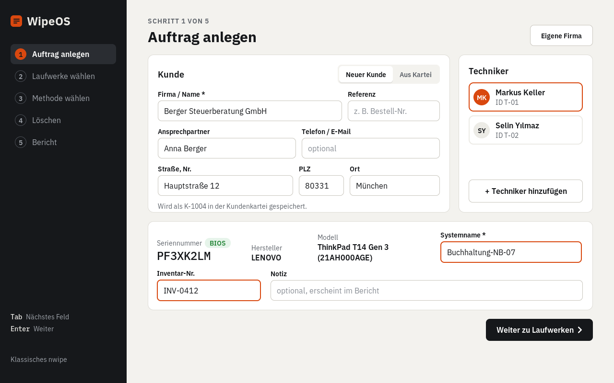
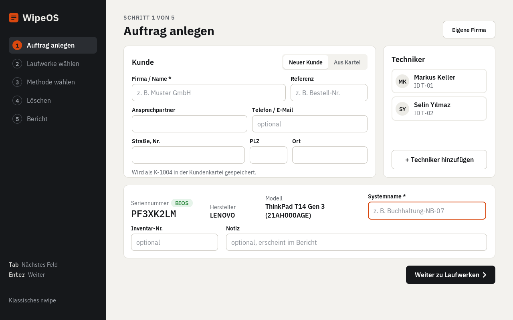
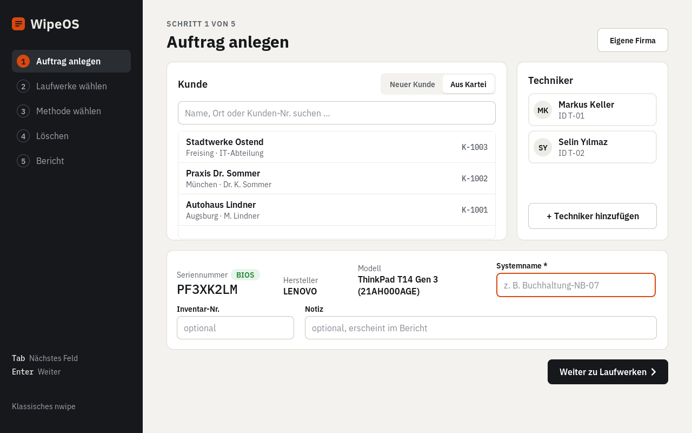
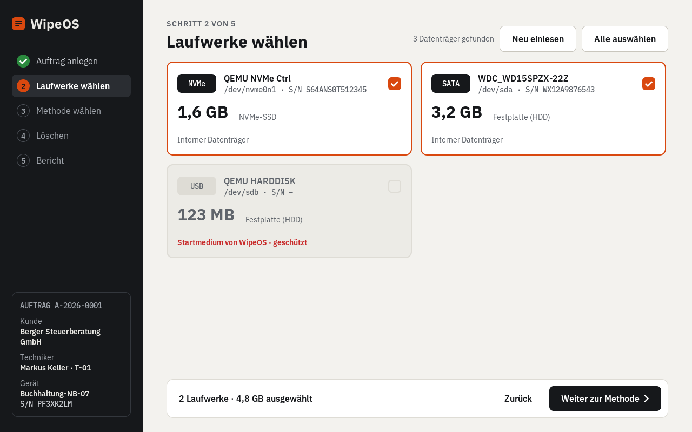
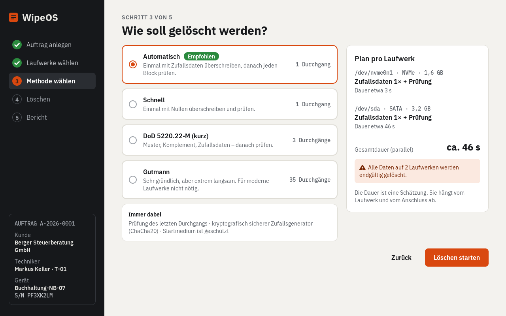
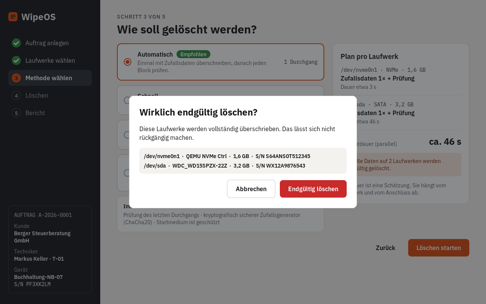
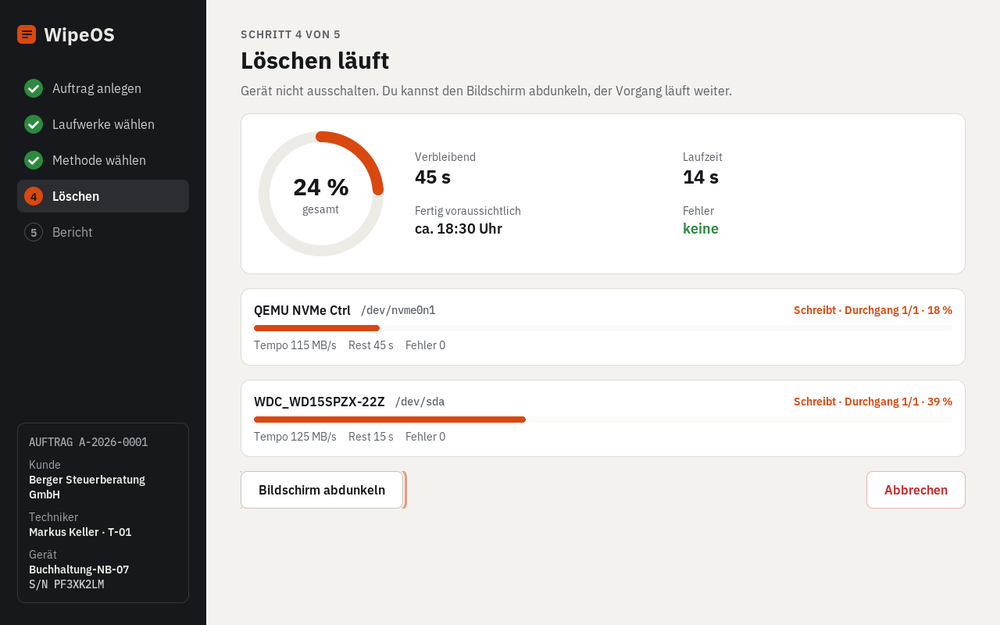
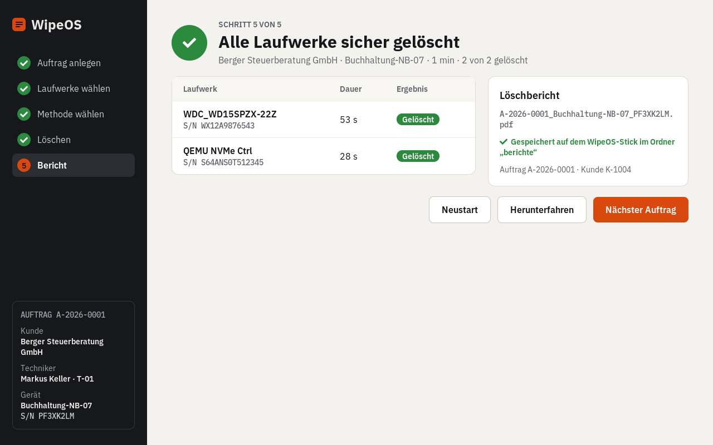
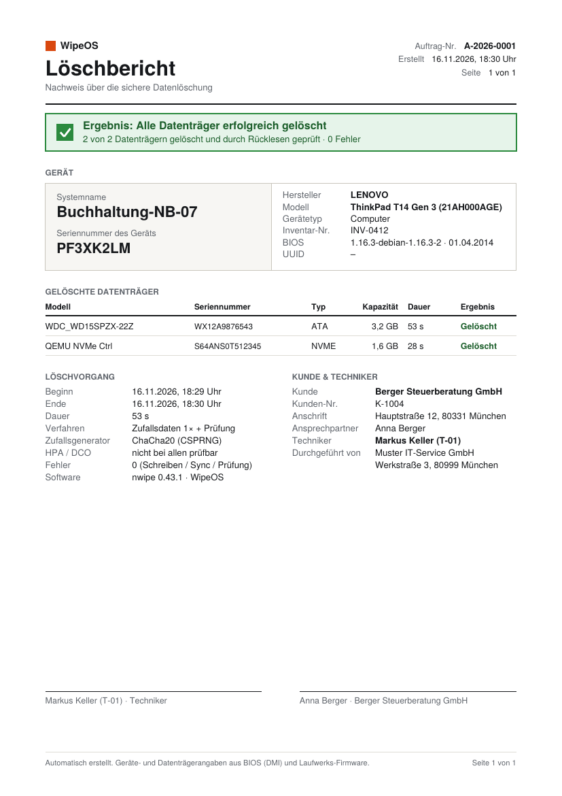

# WipeOS

**Festplatten sicher löschen – mit Kunde, Techniker und Löschbericht.**

WipeOS ist ein bootfähiger USB-Stick zum sicheren Löschen von Festplatten und SSDs.
Er basiert auf [ShredOS](https://github.com/PartialVolume/shredos.x86_64) und
[nwipe](https://github.com/martijnvanbrummelen/nwipe) und ersetzt deren Textoberfläche
durch eine grafische Oberfläche in fünf Schritten. Am Ende entsteht pro Gerät ein
PDF-Löschbericht mit Kunde, Techniker, Seriennummer des Geräts und allen gelöschten
Datenträgern. Der Bericht wird direkt auf dem Stick gespeichert.



---

## Inhalt

- [Funktionen](#funktionen)
- [Download und USB-Stick erstellen](#download-und-usb-stick-erstellen)
- [Anleitung](#anleitung)
- [Der Löschbericht](#der-löschbericht)
- [Daten auf dem Stick](#daten-auf-dem-stick)
- [Boot-Optionen](#boot-optionen)
- [Wichtige Hinweise](#wichtige-hinweise)
- [Selbst bauen](#selbst-bauen)
- [Aufbau des Repositorys](#aufbau-des-repositorys)
- [Lizenzen und Danksagung](#lizenzen-und-danksagung)

---

## Funktionen

- **Auftrag anlegen:** Kunde neu anlegen oder aus der Kundenkartei wählen, Techniker auswählen
- **Gerät automatisch erkennen:** Seriennummer, Hersteller und Modell kommen aus dem BIOS (DMI)
- **Systemname, Inventarnummer und Notiz** frei eintragbar
- **Laufwerke wählen:** Karten mit Modell, Seriennummer und Größe. Der WipeOS-Stick selbst ist gesperrt
- **Löschen mit Prüfung:** Überschreiben mit nwipe, danach wird jeder Block zurückgelesen
- **Live-Fortschritt** pro Laufwerk mit Tempo, Restzeit und Fehlerzähler
- **PDF-Löschbericht** pro Gerät, automatisch auf dem Stick gespeichert
- **Bedienung mit Maus, Touchscreen oder Tastatur** (deutsches Tastaturlayout mit Umlauten)
- **Fortlaufende Auftrags- und Kundennummern**, die Neustarts überstehen
- Die **klassische nwipe-Oberfläche** bleibt erreichbar (z. B. für ATA Secure Erase / NVMe Sanitize)

---

## Download und USB-Stick erstellen

1. **Image herunterladen:** `WipeOS.img` unter [Releases](../../releases/latest).
2. **Auf einen USB-Stick schreiben** (mindestens 128 MB). **Alles auf dem Stick wird gelöscht.**

| System  | Programm | So geht's |
|---------|----------|-----------|
| Windows | [Rufus](https://rufus.ie) | Stick wählen → „AUSWAHL“ → `WipeOS.img` → Start. Bei Nachfrage **„Im DD-Image-Modus schreiben“** wählen. |
| Windows / macOS / Linux | [balenaEtcher](https://etcher.balena.io) | „Flash from file“ → `WipeOS.img` → Stick wählen → „Flash!“ |
| Linux | `dd` | `sudo dd if=WipeOS.img of=/dev/sdX bs=4M status=progress conv=fsync` (`sdX` = der Stick!) |

3. **Vom Stick starten:** Stick einstecken, Gerät einschalten und das Boot-Menü öffnen
   (je nach Hersteller **F12**, **F9**, **F11** oder **Esc**). Den USB-Stick wählen.
   Im Startmenü startet „WipeOS“ nach einigen Sekunden automatisch.

> **Tipp:** Wenn der Stick nicht startet, im BIOS/UEFI „Secure Boot“ deaktivieren.

---

## Anleitung

### Schritt 1 – Auftrag anlegen

Nach dem Start erscheint direkt die Oberfläche. Seriennummer, Hersteller und Modell des
Geräts sind bereits ausgefüllt.



- **Kunde:** Unter **„Neuer Kunde“** Firma oder Name eingeben (Pflicht), dazu optional
  Ansprechpartner, Anschrift, Telefon/E-Mail und eine Referenz. Der Kunde bekommt
  automatisch eine Kundennummer (z. B. `K-1004`) und landet in der Kundenkartei.
- **Bestehende Kunden** findest du unter **„Aus Kartei“**. Die Liste lässt sich nach
  Name, Ort oder Kundennummer durchsuchen.



- **Techniker:** Antippen zum Auswählen. Neue Techniker legst du über
  **„+ Techniker hinzufügen“** an (Name und ID).
- **Gerät:** Einen **Systemnamen** vergeben (Pflicht, z. B. `Buchhaltung-NB-07`),
  optional Inventarnummer und Notiz.
- **Eigene Firma** (oben rechts): Name und Anschrift deiner Firma. Sie erscheinen im
  Bericht unter „Durchgeführt von“. Das musst du nur einmal eintragen.


Mit **„Weiter zu Laufwerken“** wird der Auftrag angelegt und erhält eine Auftragsnummer
(z. B. `A-2026-0001`).

### Schritt 2 – Laufwerke wählen

Alle eingebauten und angeschlossenen Datenträger werden als Karten angezeigt.
Zu löschende Laufwerke antippen. Der WipeOS-Stick ist als **Startmedium gesperrt**
und kann nicht ausgewählt werden.



### Schritt 3 – Methode wählen

| Methode | Was passiert | Wann |
|---|---|---|
| **Automatisch** (empfohlen) | 1× Zufallsdaten, danach Prüfung | Standard für HDD und SSD |
| **Schnell** | 1× Nullen, danach Prüfung | wenn es schnell gehen soll |
| **DoD 5220.22-M (kurz)** | 3 Durchgänge, danach Prüfung | wenn ein Standard gefordert ist |
| **Gutmann** | 35 Durchgänge, danach Prüfung | praktisch nie nötig, sehr langsam |

Rechts siehst du den Plan pro Laufwerk und die geschätzte Dauer.



**„Löschen starten“** öffnet eine Sicherheitsabfrage mit allen betroffenen Laufwerken.
Erst **„Endgültig löschen“** startet den Vorgang.



### Schritt 4 – Löschen läuft

Alle Laufwerke werden gleichzeitig gelöscht. Der Ring zeigt den Gesamtfortschritt,
darunter stehen Tempo, Restzeit und Fehler pro Laufwerk. Blau bedeutet „wird geprüft“,
grün bedeutet „fertig“.



- **„Bildschirm abdunkeln“** schaltet die Anzeige schwarz. Antippen weckt sie wieder auf.
- **„Abbrechen“** fragt nach und bricht dann ab. Der Abbruch wird im Bericht vermerkt.
- **Gerät nicht ausschalten**, solange gelöscht wird.

### Schritt 5 – Fertig

Das Ergebnis pro Laufwerk wird angezeigt, der Löschbericht ist bereits auf dem Stick
gespeichert.



- **Nächster Auftrag:** neues Gerät für denselben Kunden und Techniker
- **Herunterfahren / Neustart:** Danach kann der Stick abgezogen werden.

---

## Der Löschbericht

Pro Gerät entsteht **eine PDF-Seite** im Ordner `berichte` auf dem Stick, z. B.
`A-2026-0001_Buchhaltung-NB-07_PF3XK2LM.pdf`. Inhalt:

- Ergebnis (grün: alles gelöscht / rot: Fehler oder Abbruch)
- **Gerät:** Systemname, Seriennummer, Hersteller, Modell, Gerätetyp, Inventar-Nr., BIOS, UUID
- **Gelöschte Datenträger:** Modell, Seriennummer, Typ, Kapazität, Dauer, Ergebnis
- **Löschvorgang:** Beginn, Ende, Dauer, Verfahren, Zufallsgenerator, HPA/DCO, Fehler, Software
- **Kunde & Techniker:** Kunde, Kunden-Nr., Anschrift, Ansprechpartner, Techniker, eigene Firma
- Unterschriftszeilen für Techniker und Kunde



Neben dem PDF liegt das vollständige nwipe-Protokoll (`…_nwipe.log`).

---

## Daten auf dem Stick

Der Stick enthält eine normale FAT32-Partition („WIPEOS“), die an jedem PC lesbar ist:

| Pfad | Inhalt |
|---|---|
| `berichte\` | Löschberichte (PDF) und nwipe-Protokolle |
| `wipeos\kunden.csv` | Kundenkartei, Trennzeichen Semikolon (Excel/LibreOffice) |
| `wipeos\techniker.csv` | Techniker (`ID;Name`) |
| `wipeos\firma.txt` | Eigene Firma: Zeile 1 Name, Zeile 2 Anschrift |
| `wipeos\auftragsnummer.txt` | Zähler für die Auftragsnummern (Jahr und Nummer) |
| `ANLEITUNG.txt` | Kurzanleitung |

Kunden und Techniker lassen sich am PC vorbereiten oder in eine andere Kundenkartei
übernehmen. Auf der Partition sind rund 15 MB frei, das reicht für mehrere hundert Berichte.
Berichte regelmäßig auf den PC kopieren.

---

## Boot-Optionen

| Startmenü-Eintrag | Wirkung |
|---|---|
| **WipeOS** | Normaler Start mit der neuen Oberfläche |
| **WipeOS (klassische nwipe-Oberfläche)** | Startet die ursprüngliche nwipe-Textoberfläche |
| **WipeOS (nomodeset – bei Anzeigeproblemen)** | Für Geräte, deren Grafik nicht richtig startet |

Zusätzliche Parameter (im Startmenü mit **e** an die `linux`-Zeile anhängen):

- `wipeos_kbd=us` – US-Tastaturlayout statt deutsch
- `wipeos_gui=0` – klassische Oberfläche

Die klassische Oberfläche erreichst du auch in Schritt 1 über **„Klassisches nwipe“**
unten links. **Strg+Alt+F2** öffnet eine Konsole.

---

## Wichtige Hinweise

- **Testen vor dem Ernstfall:** WipeOS ist bisher in einer virtuellen Maschine
  (QEMU, SATA und NVMe) vollständig getestet, aber noch nicht auf vielen echten Geräten.
  Mach den ersten Durchlauf mit einer Platte, deren Daten unwichtig sind.
- **Hardware-Löschung (ATA Secure Erase / NVMe Sanitize)** bietet die neue Oberfläche noch
  nicht an. Sie ist über die klassische nwipe-Oberfläche verfügbar.
- **Zufallsgenerator:** WipeOS nutzt immer ChaCha20, einen kryptografisch sicheren Generator.
- **Uhrzeit im Bericht:** Sie kommt aus der Hardware-Uhr des gelöschten Geräts.
- **Ohne WipeOS-Stick-Partition** (z. B. als ISO gestartet) speichert WipeOS nur im
  Arbeitsspeicher. Darauf weist die Oberfläche hin.

---

## Selbst bauen

Voraussetzungen (Ubuntu 24.04 oder Debian 12):

```bash
sudo apt install build-essential git rsync bc cpio unzip file wget \
  libncurses-dev libssl-dev libelf-dev mtools dosfstools pkg-config automake
```

Bauen:

```bash
git clone --recurse-submodules https://github.com/adblocker-1/WipeOS.git
cd WipeOS
./build.sh
```

`build.sh` lädt ShredOS in der getesteten Version, wendet die WipeOS-Änderungen an und
baut mit Buildroot. Das fertige Image liegt danach in `out/WipeOS.img`. Der erste Build
dauert 2–4 Stunden und braucht rund 30 GB Speicher. Spätere Builds gehen deutlich schneller.

Ohne echte Hardware ausprobieren (benötigt `qemu-system-x86`):

```bash
tools/vm-test.sh out/WipeOS.img
```

Die Oberfläche lässt sich auch ohne Bildschirm auf einem normalen Linux-PC bauen und
testen. Dabei entstehen Bildschirmfotos:

```bash
cd gui && make
SHREDOS_HEADLESS=1280x800 SHREDOS_TEST_SCRIPT="demo;shot:/tmp/schritt1.ppm" ./shredos-gui
```

---

## Aufbau des Repositorys

```
gui/                      Grafische Oberfläche (C, LVGL 9.2, Framebuffer + evdev)
  app/ui.c                Bildschirme der fünf Schritte
  app/report.c            PDF-Löschbericht (PDFGen)
  app/wipe.c              Startet nwipe und liest den Fortschritt
  app/sysinfo.c           Seriennummer (DMI) und Datenträger (/sys/block)
  app/storage.c           Kundenkartei, Techniker, Nummern auf dem Stick
  app/input.c             Maus, Touch und Tastatur (deutsches Layout)
  lvgl/                   LVGL (Git-Submodul)
buildroot/                Ergänzungen für den ShredOS-Build
  shredos.patch           Änderungen an ShredOS (Start, Boot-Menü, Name, Pakete)
  package/shredos-gui/    Buildroot-Paket der Oberfläche
  package/nwipe/          nwipe-Patch: Option --status-file für den Live-Fortschritt
  board/shredos/          Startskript, Kurzanleitung, Vorlage firma.txt
docs/bilder/              Bildschirmfotos für diese Anleitung
tools/                    QEMU-Testskript und QMP-Helfer
build.sh                  Baut das komplette Image
```

So funktioniert es: Beim Start hängt `shredos_gui_launcher` die Stick-Partition ein
und startet die Oberfläche. Sie zeichnet direkt in den Framebuffer und startet für das
Löschen `nwipe --nogui --autonuke` mit den gewählten Laufwerken. Über die neue Option
`--status-file` schreibt nwipe jede Sekunde den Fortschritt in eine Datei, die die
Oberfläche anzeigt. Am Ende erzeugt sie daraus den PDF-Bericht.

---

## Lizenzen und Danksagung

- **WipeOS-Oberfläche** (`gui/app`, Skripte): GNU GPL v3, siehe [LICENSE](LICENSE)
- **nwipe-Patch** (`buildroot/package/nwipe`): GNU GPL v2, wie nwipe
- **[ShredOS](https://github.com/PartialVolume/shredos.x86_64)** von PartialVolume: GNU GPL v2
- **[nwipe](https://github.com/martijnvanbrummelen/nwipe)** von Martijn van Brummelen und PartialVolume: GNU GPL v2
- **[LVGL](https://lvgl.io)**: MIT
- **PDFGen** von Andre Renaud: Public Domain
- **IBM Plex** Schriften: SIL Open Font License 1.1 (`gui/app/IBM-Plex-OFL-1.1.txt`)

Vielen Dank an die Entwickler von ShredOS und nwipe. Ohne ihre Arbeit gäbe es WipeOS nicht.
