<p align="center">
  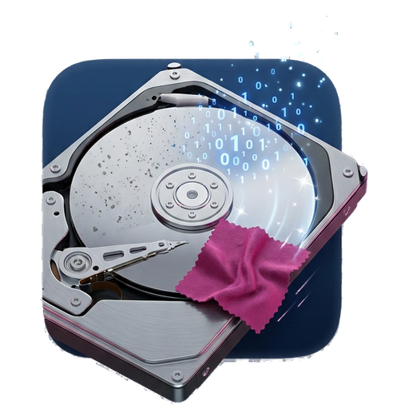
</p>

<h1 align="center">WipeOS</h1>

<p align="center"><strong>Securely erase hard drives and SSDs – with customer, technician and erasure report.</strong></p>

WipeOS is a bootable USB stick for securely erasing hard drives and SSDs. It is based on
[ShredOS](https://github.com/PartialVolume/shredos.x86_64) and
[nwipe](https://github.com/martijnvanbrummelen/nwipe) and replaces their text interface with
a graphical, five-step workflow. For every device it creates a PDF erasure report with the
customer, the technician, the device serial number and every erased drive – saved directly
to the stick.

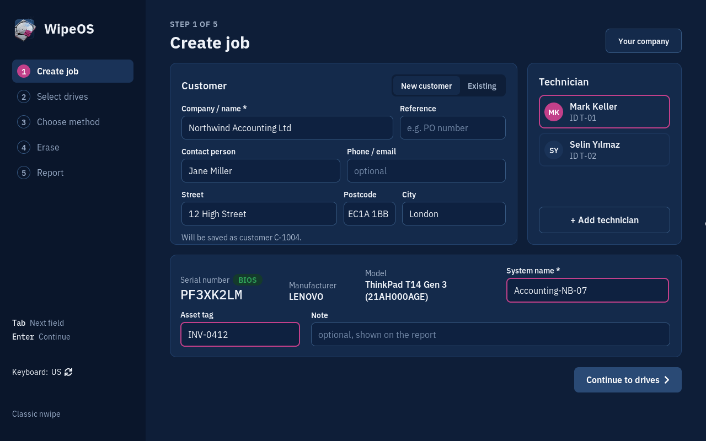

---

## Contents

- [Features](#features)
- [Download and create the USB stick](#download-and-create-the-usb-stick)
- [User guide](#user-guide)
- [Erasure methods](#erasure-methods)
- [The erasure report](#the-erasure-report)
- [Company logo](#company-logo)
- [Files on the stick](#files-on-the-stick)
- [Boot options](#boot-options)
- [Important notes](#important-notes)
- [Building from source](#building-from-source)
- [Repository layout](#repository-layout)
- [Licenses and credits](#licenses-and-credits)

---

## Features

- **Create a job:** add a new customer or pick one from the customer list, choose the technician
- **Automatic device detection:** serial number, manufacturer and model are read from the BIOS (DMI)
- **System name, asset tag and note** for every device
- **Drive selection:** cards with model, serial number and capacity. The WipeOS stick itself is locked
- **All 12 nwipe erasure methods** and **all 8 random number generators**, with verification,
  rounds and an optional final blanking pass
- **Live progress** per drive with speed, remaining time and error count
- **PDF erasure report** per device in your company letterhead – **with your own company logo** –
  saved automatically on the stick
- **Keyboard, mouse, touchpad or touchscreen** – US and German keyboard layouts, switchable in the UI
- **High-resolution displays:** QHD and 4K screens are enlarged automatically (zoom 100 % / 200 %)
- **Consecutive job and customer numbers** that survive reboots
- The **classic nwipe interface** is still available (e.g. for ATA Secure Erase / NVMe Sanitize)

---

## Download and create the USB stick

1. **Download the image:** `WipeOS.img` from [Releases](../../releases/latest).
2. **Write it to a USB stick** (at least 128 MB). **Everything on the stick will be erased.**

| System | Tool | How |
|---|---|---|
| Windows | [Rufus](https://rufus.ie) | Select the stick → "SELECT" → `WipeOS.img` → Start. When asked, choose **"Write in DD Image mode"**. |
| Windows / macOS / Linux | [balenaEtcher](https://etcher.balena.io) | "Flash from file" → `WipeOS.img` → select the stick → "Flash!" |
| Linux | `dd` | `sudo dd if=WipeOS.img of=/dev/sdX bs=4M status=progress conv=fsync` (`sdX` = the stick!) |

3. **Boot from the stick:** plug it in, switch the computer on and open the boot menu
   (depending on the manufacturer **F12**, **F9**, **F11** or **Esc**). Choose the USB stick.
   "WipeOS" starts automatically after a few seconds.

> **Tip:** if the stick does not boot, disable "Secure Boot" in the BIOS/UEFI settings.

---

## User guide

### Step 1 – Create job

The interface appears right after booting. Serial number, manufacturer and model of the
device are already filled in.

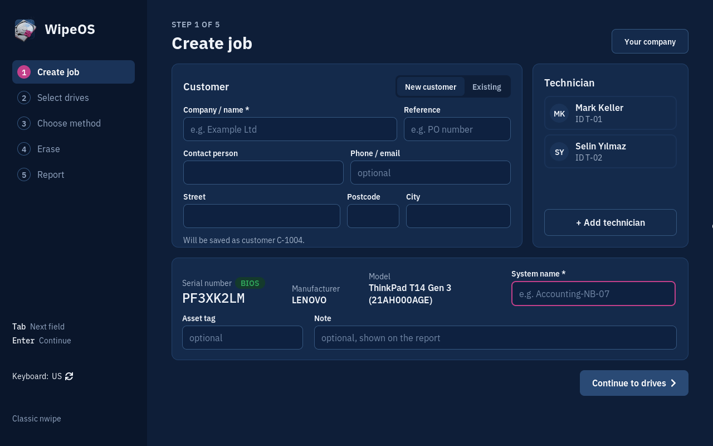

- **Customer:** under **"New customer"** enter the company or name (required) and optionally
  contact person, address, phone/email and a reference. The customer automatically gets a
  customer number (e.g. `C-1004`) and is added to the customer list.
- **Existing customers** are listed under **"Existing"** and can be searched by name, city or
  customer number.

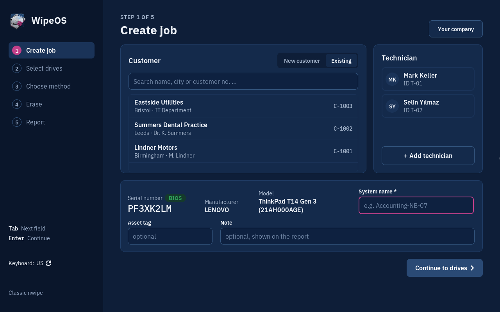

- **Technician:** tap to select. Add new technicians with **"+ Add technician"** (name and ID).
- **Device:** enter a **system name** (required, e.g. `Accounting-NB-07`) and optionally an
  asset tag and a note.
- **Your company** (top right): company name, address, phone/email and your **company logo**.
  They appear in the letterhead of every report. You only need to set this up once
  (see [Company logo](#company-logo)).
- **Keyboard** (bottom left): switches between the US and German layout. You can start typing
  right away – the first field is already selected. **Tab** moves to the next field.
- **Mouse:** USB mice, laptop touchpads (tap = click, two fingers = scroll) and touchscreens work.
- **Zoom** (bottom left, only on high-resolution displays): switches between 100 % and 200 %.
  From 2560 × 1440 upwards WipeOS starts with 200 % automatically; the choice is saved on the stick.


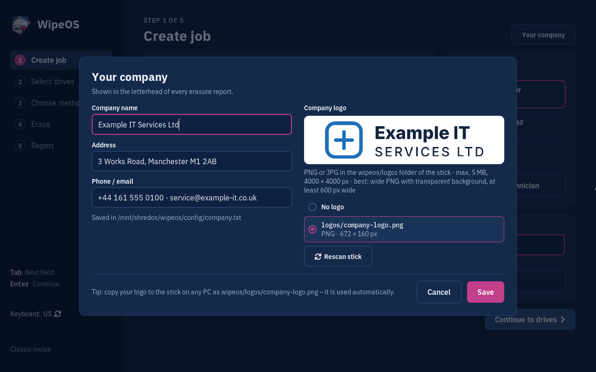

**"Continue to drives"** creates the job and assigns a job number (e.g. `WO-2026-0001`).

### Step 2 – Select drives

All internal and connected drives are shown as cards. Tap the drives you want to erase.
The WipeOS stick is marked as **boot drive** and cannot be selected.

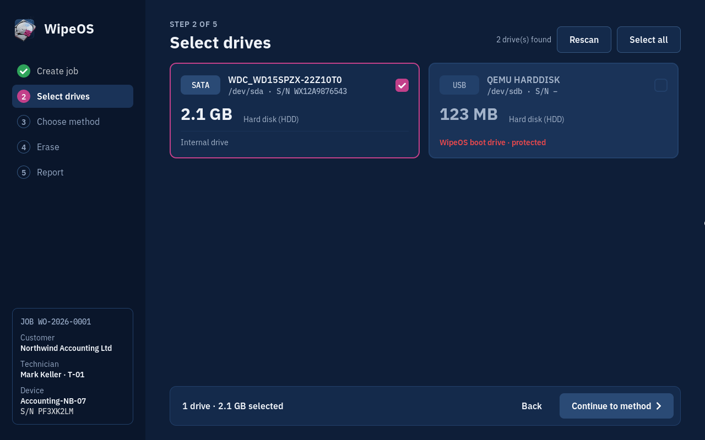

### Step 3 – Choose method

Choose one of the 12 nwipe methods (see [Erasure methods](#erasure-methods)) and set the options
on the right: random generator, verification, rounds and an optional final blanking pass with
zeros. The plan shows the estimated time per drive.

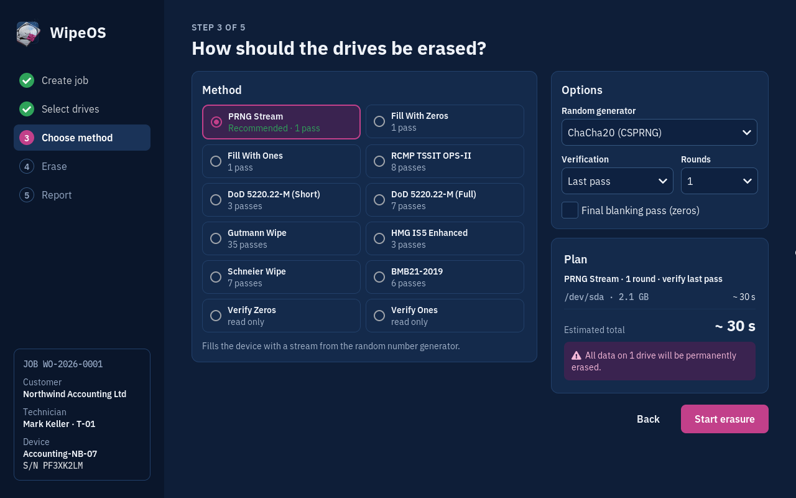

**"Start erasure"** opens a confirmation dialog listing all affected drives. The erasure only
starts after **"Erase permanently"**.

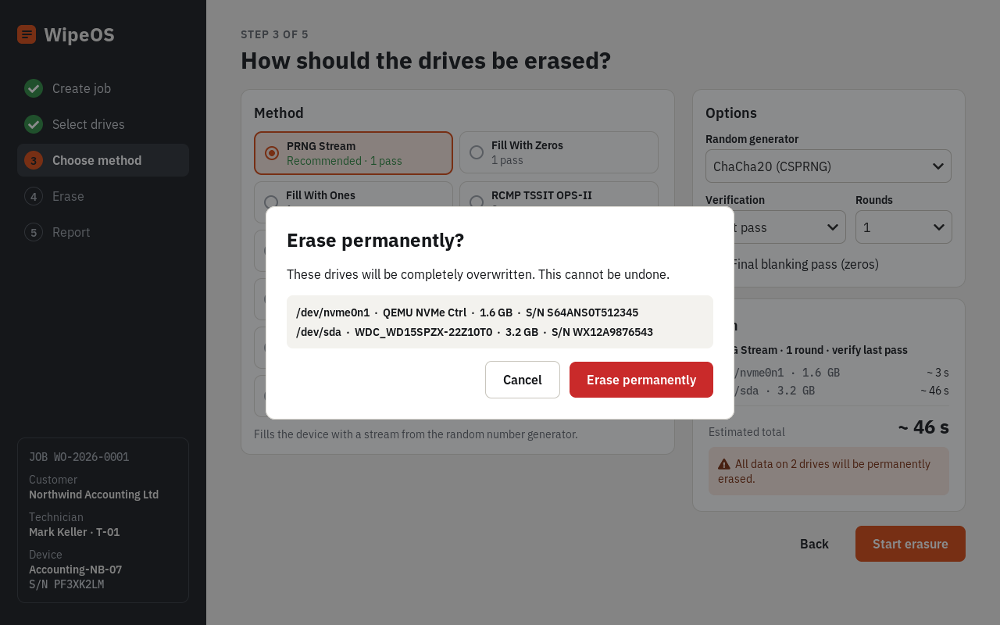

### Step 4 – Erasing

All drives are erased at the same time. The ring shows the overall progress, below it you see
speed, remaining time and errors per drive. Pink means "writing", blue means "verifying",
green means "done".

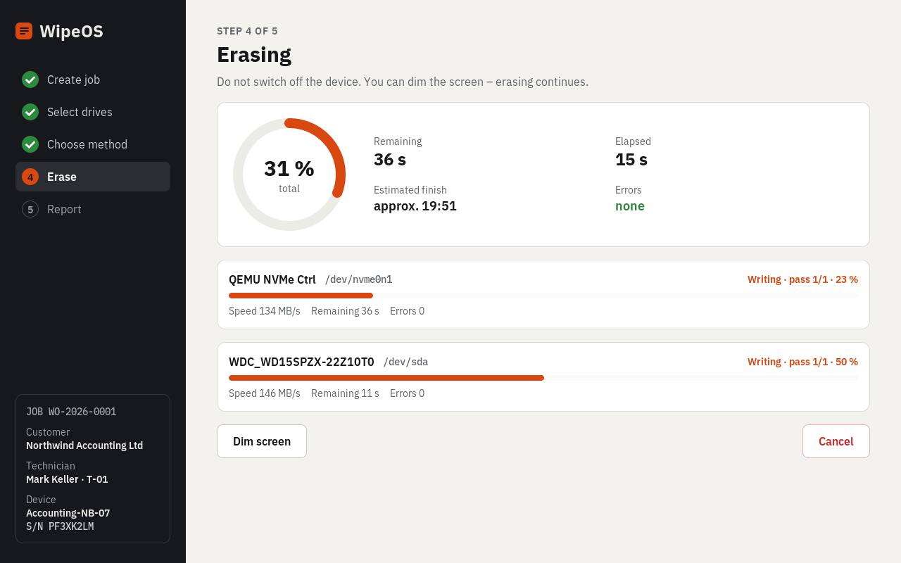

- **"Dim screen"** turns the display black. Tap to wake it up.
- **"Cancel"** asks for confirmation and then aborts. The abort is recorded in the report.
- **Do not switch off the device** while erasing.

### Step 5 – Finished

The result for each drive is shown and the erasure report has already been saved to the stick.

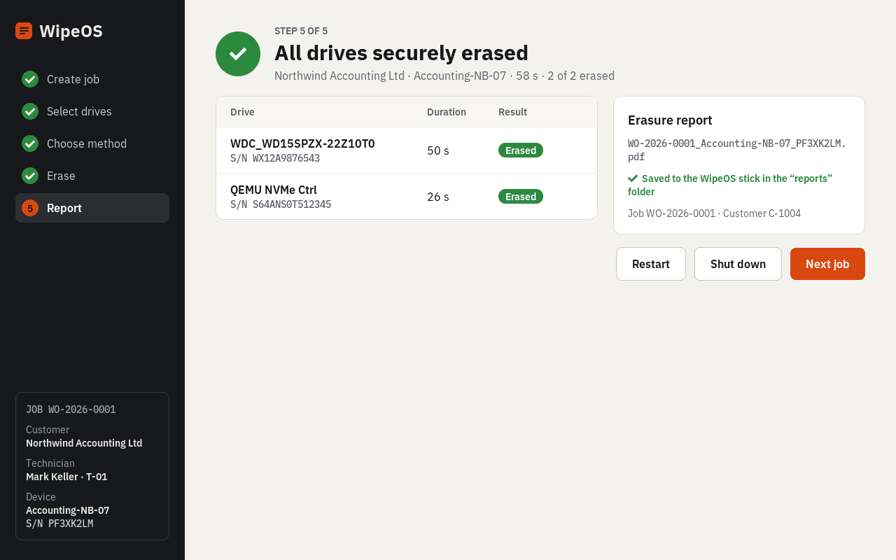

- **Next job:** a new device for the same customer and technician
- **Shut down / Restart:** afterwards the stick can be removed.

---

## Erasure methods

| Method | Passes | Description |
|---|---|---|
| **PRNG Stream** (recommended) | 1 | Fills the device with a stream from the random number generator. |
| Fill With Zeros | 1 | Fills the device with zeros (0x00). |
| Fill With Ones | 1 | Fills the device with ones (0xFF). |
| RCMP TSSIT OPS-II | 8 | Royal Canadian Mounted Police Technical Security Standard, OPS-II. |
| DoD 5220.22-M (Short) | 3 | U.S. Department of Defense 5220.22-M short 3-pass wipe (passes 1, 2 & 7). |
| DoD 5220.22-M (Full) | 7 | U.S. Department of Defense 5220.22-M full 7-pass wipe. |
| Gutmann Wipe | 35 | Peter Gutmann's method (Secure Deletion of Data from Magnetic and Solid-State Memory). |
| HMG IS5 Enhanced | 3 | UK HMG IS5 (Enhanced) sanitisation method for protectively marked or sensitive information. |
| Schneier Wipe | 7 | Bruce Schneier's 7-pass mixed-pattern algorithm. |
| BMB21-2019 | 6 | Chinese State Secrets Bureau BMB21-2019 technical requirement for data sanitisation. |
| Verify Zeros | read only | Only reads the device and checks that it is filled with zeros (0x00). |
| Verify Ones | read only | Only reads the device and checks that it is filled with ones (0xFF). |

**Options**

| Option | Values | Default |
|---|---|---|
| Random generator | ChaCha20 (CSPRNG), AES-256-CTR (CSPRNG, needs AES-NI), ISAAC-64 (CSPRNG), ISAAC (CSPRNG), XORoshiro-256, SplitMix64, Lagged Fibonacci, Mersenne Twister | ChaCha20 |
| Verification | Off, Last pass, All passes | Last pass |
| Rounds | 1–5 | 1 |
| Final blanking pass | writes zeros at the end, so the drive looks empty | off |

The verify methods only read the drive; their report is titled "Verification report".
For RCMP TSSIT OPS-II nwipe never adds a blanking pass.

---

## The erasure report

For every device a PDF is saved in `wipeos\reports` on the stick, e.g.
`WO-2026-0001_Accounting-NB-07_PF3XK2LM.pdf`. It is laid out like a letter from your company:

- **Letterhead:** your company logo (top left), company name, address and phone/email (top right)
- **Title and stamp:** "Erasure report", job number and date, plus a stamp
  (green "ERASED · VERIFIED" / red "NOT ERASED")
- **Customer:** customer, customer no., address, contact, phone/email, reference
- **Device:** system name, serial number, manufacturer, model, device type, asset tag, BIOS, UUID
- **Erased drives:** model, serial number, type, capacity, duration, result
- **Erasure:** start, finish, duration, method, passes and verification, random generator,
  HPA/DCO, errors, software, technician
- Signature lines for the technician and the customer, small "Erased with WipeOS" note in the footer

Without a company logo the company name is printed in the letterhead instead.

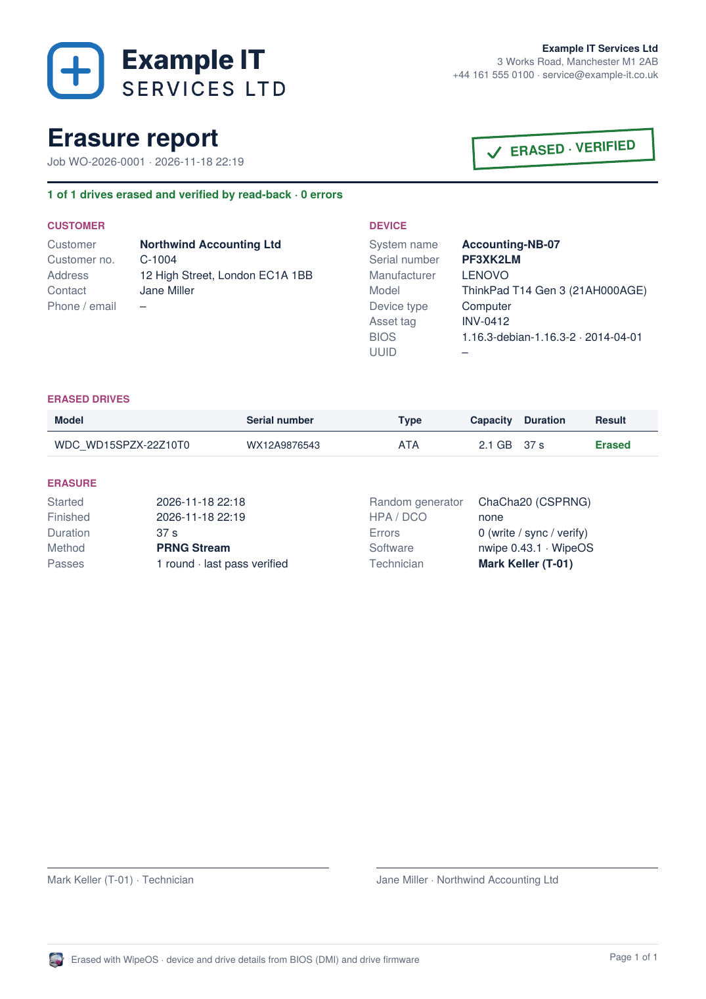

The complete nwipe log (`…_nwipe.log`) is saved next to the PDF.

---

## Company logo

Your logo is printed at the top left of every erasure report.

**How to add it**

1. Plug the WipeOS stick into any PC and open the folder **`wipeos\logos`**.
2. Copy your logo into it and name it **`company-logo.png`** (or `company-logo.jpg`) –
   it is then used automatically.
3. Alternatively copy any PNG/JPG into the folder and choose it in WipeOS under
   **"Your company"** → **Company logo**. There you can also switch between several logos or
   select **"No logo"**. **"Rescan stick"** reloads the list.

**Format and size**

| | |
|---|---|
| File format | **PNG** (transparent background recommended) or **JPG** |
| Max. file size | **5 MB** |
| Max. image size | **4000 × 4000 pixels** (min. 16 × 16) |
| Recommended | Landscape logo, **at least 600 px wide**, e.g. **1200 × 300 px** |
| Size on the report | Fitted into **70 × 18 mm** at the top left, aspect ratio is kept |
| Location | `wipeos\logos\` on the stick (up to 12 files are listed) |

Transparent borders around the logo are trimmed automatically. Very tall or square logos are
scaled down to 18 mm height, so a wide logo looks best. Files that are too large or cannot be
read are marked in red in the list and are not used.

---

## Files on the stick

The stick contains a normal FAT32 partition ("WIPEOS") that every PC can read. All your data is
in the `wipeos` folder, split into three subfolders:

| Path | Contents |
|---|---|
| `wipeos\config\company.txt` | Your company: `name=`, `address=`, `contact=`, `logo=` |
| `wipeos\config\customers.csv` | Customer list, semicolon separated (Excel/LibreOffice) |
| `wipeos\config\technicians.csv` | Technicians (`ID;Name`) |
| `wipeos\config\job_counter.txt` | Counter for job numbers (year and number) |
| `wipeos\config\settings.txt` | Display zoom chosen in the interface |
| `wipeos\logos\` | Company logos (PNG/JPG), see [Company logo](#company-logo) |
| `wipeos\reports\` | Erasure reports (PDF) and nwipe logs |
| `GUIDE.txt` | Short guide |
| `README.txt` | What WipeOS is, link to this project |
| `autorun.inf`, `wipeos.ico` | Name "WipeOS" and the WipeOS icon for the stick in Windows Explorer |
| `boot\`, `EFI\` | Boot files – do not change |

Customers and technicians can be prepared on a PC or imported from another customer list.
The partition has about 15 MB free, enough for several hundred reports. Copy reports to your
PC regularly.

> **Updating from WipeOS 1.1:** if you copy your old `wipeos` and `reports` folders onto a new
> stick, WipeOS moves the files into the new folders on the first start automatically
> (customers, technicians, job counter and reports are kept).

---

## Boot options

| Boot menu entry | Effect |
|---|---|
| **WipeOS** | Normal start with the new interface |
| **WipeOS (classic nwipe interface)** | Starts the original nwipe text interface |
| **WipeOS (nomodeset - for display problems)** | For devices whose graphics do not start correctly |

Additional parameters (press **e** in the boot menu and append them to the `linux` line):

- `wipeos_kbd=de` – German keyboard layout as default (can also be switched in the UI)
- `wipeos_scale=1` / `wipeos_scale=2` – fixed zoom (100 % / 200 %) instead of the automatic choice
- `wipeos_gui=0` – classic interface

The classic interface is also available via **"Classic nwipe"** in step 1 (bottom left).
**Ctrl+Alt+F2** opens a console.

---

## Important notes

- **Test before real use:** WipeOS has been fully tested in a virtual machine
  (QEMU with SATA and NVMe drives), but not yet on many real devices. Do your first run with a
  drive whose data does not matter.
- **Hardware erase (ATA Secure Erase / NVMe Sanitize)** is not yet offered in the new interface.
  It is available in the classic nwipe interface.
- **AES-256-CTR** requires a CPU with AES-NI. If unsure, use ChaCha20 (default).
- **Time on the report** comes from the hardware clock of the erased device.
- **Without the WipeOS stick partition** (e.g. booted from the ISO) data is only kept in memory.
  The interface shows a warning in that case.

---

## Building from source

Requirements (Ubuntu 24.04 or Debian 12):

```bash
sudo apt install build-essential git rsync bc cpio unzip file wget \
  libncurses-dev libssl-dev libelf-dev mtools dosfstools pkg-config automake
```

Build:

```bash
git clone --recurse-submodules https://github.com/adblocker-1/WipeOS.git
cd WipeOS
./build.sh
```

`build.sh` fetches the tested ShredOS version, applies the WipeOS changes and builds everything
with Buildroot. The finished image is written to `out/WipeOS.img`. The first build takes
2–4 hours and needs about 30 GB of disk space; later builds are much faster.

Try it without real hardware (requires `qemu-system-x86`):

```bash
tools/vm-test.sh out/WipeOS.img
```

The interface can also be built and tested on a normal Linux PC without a screen; it then saves
screenshots:

```bash
cd gui && make
SHREDOS_HEADLESS=1280x800 SHREDOS_TEST_SCRIPT="demo;shot:/tmp/step1.ppm" ./shredos-gui
```

---

## Repository layout

```
gui/                      Graphical interface (C, LVGL 9.2, framebuffer + evdev)
  app/ui.c                Screens of the five steps
  app/report.c            PDF erasure report in letterhead layout (PDFGen)
  app/image.c             Company logo: PNG/JPG loading, checks and scaling (stb_image)
  app/logo_data.c         WipeOS logo, generated by tools/gen_logo_data.py
  app/wipe.c              Methods, random generators, runs nwipe and reads progress
  app/sysinfo.c           Serial number (DMI) and drives (/sys/block)
  app/storage.c           Config, logos and reports folders on the stick
  app/input.c             Keyboard (US and German layouts), mouse, touchpad, touchscreen
  app/main.c              Framebuffer output with zoom for high-resolution displays
  lvgl/                   LVGL (git submodule)
buildroot/                Additions to the ShredOS build
  shredos.patch           Changes to ShredOS (startup, boot menu, name, packages, touchpad drivers)
  package/shredos-gui/    Buildroot package of the interface
  package/nwipe/          nwipe patch: --status-file option for live progress
  board/shredos/          Startup script, short guide, company.txt and folder templates
docs/images/              Logo and the screenshots used in this guide
tools/                    QEMU test script, QMP helper, logo generator
build.sh                  Builds the complete image
```

How it works: at boot `shredos_gui_launcher` mounts the stick partition and starts the
interface. It draws directly to the framebuffer and, to erase, runs
`nwipe --nogui --autonuke` with the selected method, options and drives. Through the new
`--status-file` option nwipe writes its progress to a file every second, which the interface
displays. At the end the interface creates the PDF report from it.

---

## Licenses and credits

- **WipeOS interface** (`gui/app`, scripts): GNU GPL v3
- **nwipe patch** (`buildroot/package/nwipe`): GNU GPL v2, like nwipe
- **[ShredOS](https://github.com/PartialVolume/shredos.x86_64)** by PartialVolume: GNU GPL v2
- **[nwipe](https://github.com/martijnvanbrummelen/nwipe)** by Martijn van Brummelen and PartialVolume: GNU GPL v2
- **[LVGL](https://lvgl.io)**: MIT
- **[GRUB](https://www.gnu.org/software/grub/)** boot loader (`EFI\BOOT`, `buildroot/board/shredos/bootia32.efi`): GNU GPL v3
- **PDFGen** by Andre Renaud: public domain
- **[stb_image](https://github.com/nothings/stb)** by Sean Barrett: public domain
- **IBM Plex** fonts: SIL Open Font License 1.1 (`gui/app/IBM-Plex-OFL-1.1.txt`)

Many thanks to the developers of ShredOS and nwipe – without their work WipeOS would not exist.
